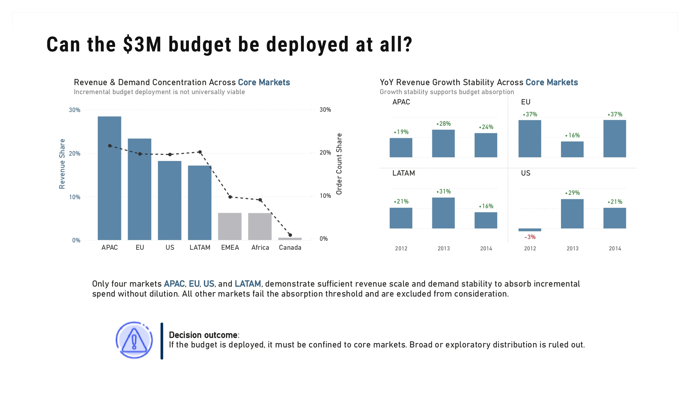
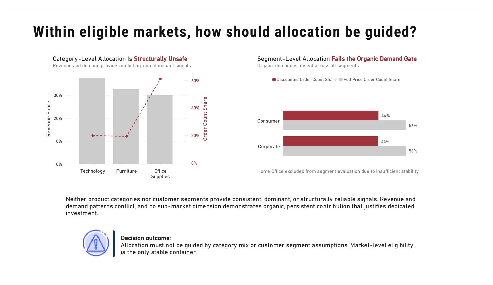
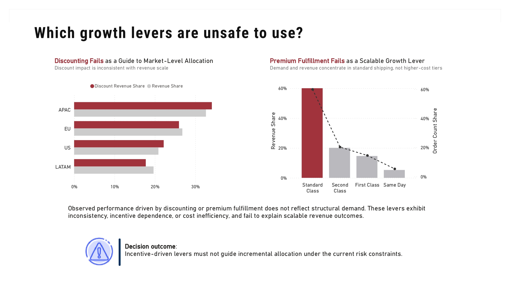

# Decision-Gated Analysis

> A decision-gated SQL and Power BI analysis that screens where a $3M growth budget can be deployed without inflating long-term demand risk.

**Result:** The $3M growth budget should not be deployed as scoped. <br>
**Gate:** Future eligibility is restricted to APAC, EU, US, and LATAM, and requires a lever that works without increasing discounts.

## The Decision

A global e-commerce company operates across multiple regions but lacks clear data on where sustainable demand originates. For the 2015 planning cycle it set aside an incremental **$3M growth budget**.

- The budget was deployable only if it grew demand without increasing long-term demand risk.
- Markets were expected to absorb more investment without returns dropping off.
- Growth had to persist without constant discounting, building the core business instead of a temporary bump.

**Decision:** How to allocate an incremental $3M growth budget
**Scope:** 2015 planning cycle

**Objectives:**

- Identify markets capable of absorbing the $3M budget and exclude those that cannot
- Distinguish structural demand drivers from incentive-based levers
- Define the conditions under which deploying the budget would create unacceptable risk or future regret


## What the Data Showed

Each assumption behind the budget was checked against transaction data and either survived or was ruled out.

### Market Readiness

*Assumption: Spreading the budget across all active markets would maximize growth.*

Demand is concentrated. Four regions (APAC, EU, US, LATAM) account for 87% of revenue and 80% of orders. EMEA and Africa lack the volume to justify spend, and Canada shows weak demand health.

**Insight:** Spreading the budget across all active markets is not viable.



### Product and Customer Segmentation

*Assumption: Concentrating incremental investment on top-selling categories or high-value customers.*

Below the regional level, the signals break down. Technology and Furniture match Office Supplies in revenue with far fewer orders. The Home Office segment is too small and volatile to anchor a commitment.

**Insight:** Picking winners at this depth is too risky for a $3M commitment.



### Operational Levers

*Assumption: Incentives or operational levers can be used to guide incremental investment.*

Discounts did not consistently link to market growth, with some large markets relying heavily on them and others not. Faster shipping did not increase willingness to pay, as 60% of demand stayed in the standard tier. Nearly half of all orders were driven by discounts.

**Insight:** These levers show a response to incentives rather than underlying demand, which is not a sustainable foundation for spending capital.




## Recommendation

**The $3M growth budget should not be deployed.** None of the evaluated growth paths showed an ability to absorb capital without relying on incentives or losing efficiency.

Future deployment requires:

- Restricting eligibility to APAC, EU, US, and LATAM
- Finding a growth lever that works without increasing discounts

The full decision narrative and evidence pages are in the [Power BI report (PDF)](power_bi/artifacts/growth_budget_allocation_report.pdf).


## Analysis Structure

Raw transactions are validated and corrected, screened through decision gates, then extracted for reporting. Only signals material enough to change an allocation decision survive the pipeline.

| Stage | Purpose |
| --- | --- |
| [`01_data_cleaning.sql`](sql/scripts/01_data_cleaning.sql) | Ingest raw data, validate quality and consistency, apply targeted corrections |
| [`02_exploratory_data_analysis.sql`](sql/scripts/02_exploratory_data_analysis.sql) | Screen allocation through demand, scale, and risk gates; eliminate narratives that are incentive-driven or do not scale |
| [`03_reporting_extract.sql`](sql/scripts/03_reporting_extract.sql) | Extract reporting data derived from validated analysis outputs |

## Repository Structure

```
├── data/
│   ├── raw/                                   # original source data
│   ├── processed/                             # cleaned and validated data
│   └── exported_tables/                       # extracts ready for reporting
├── sql/
│   └── scripts/
│       ├── 01_data_cleaning.sql               # data validation and corrections
│       ├── 02_exploratory_data_analysis.sql   # decision gate analysis
│       └── 03_reporting_extract.sql           # final reporting outputs
├── docs/
│   ├── decision_logs.md                       # decision framework and evaluation structure
│   ├── analysis_pipeline.md                   # analytical flow and logic
│   ├── data_dictionary.md                     # field definitions
│   ├── preprocessing_log.md                   # data handling decisions
│   └── decision_gate_rationale.md             # decision constraints and growth narratives ruled out
└── power_bi/
    ├── artifacts/                             # exported decision artifacts (PDF and images)
    │   └── images/                            # exported image previews of decision pages
    └── reports/                               # Power BI reports and model files (PBIX)
```

## Reproducing the Analysis

Requires Microsoft SQL Server and Power BI Desktop.

1. Load [`data/raw/Global-Superstore.csv`](data/raw/Global-Superstore.csv) into SQL Server.
2. Run the scripts in [`sql/scripts/`](sql/scripts/) in order: `01`, `02`, then `03`.
3. Validated data lands in [`data/processed/sales_transaction.csv`](data/processed/sales_transaction.csv) and reporting extracts in [`data/exported_tables/`](data/exported_tables/).
4. Open the PBIX in [`power_bi/reports/`](power_bi/reports/) and refresh against the extracted tables.

## Documentation Index

| Document | Covers |
| --- | --- |
| [`decision_logs.md`](docs/decision_logs.md) | Decision owners, what each gate rules out, and stop rules |
| [`analysis_pipeline.md`](docs/analysis_pipeline.md) | Pipeline stages, validation, and analysis intent |
| [`data_dictionary.md`](docs/data_dictionary.md) | Field-level definitions for the processed dataset |
| [`preprocessing_log.md`](docs/preprocessing_log.md) | Data quality issues, corrections, and exclusions |
| [`decision_gate_rationale.md`](docs/decision_gate_rationale.md) | Gate logic and the growth narratives ruled out |

## Scope Boundaries

This project intentionally does **not**:

- Optimize spend mix or execution tactics
- Rank or prioritize within surviving options
- Recommend growth actions absent structural demand

Its purpose is to establish eligibility, exclusion, and risk boundaries.
